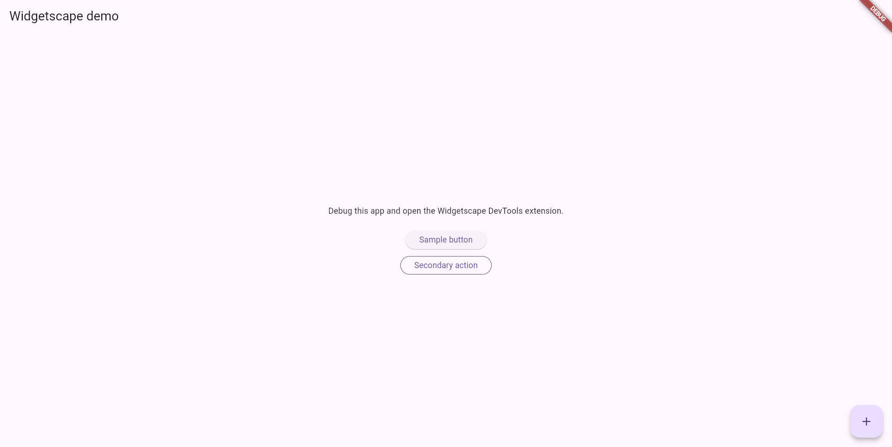
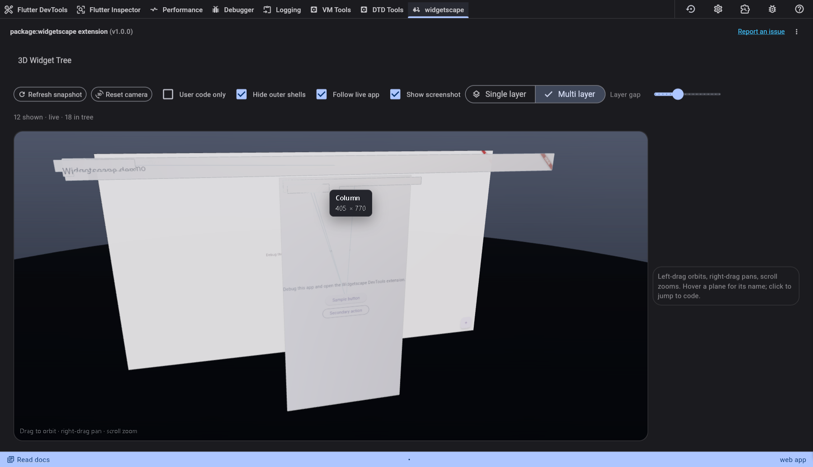
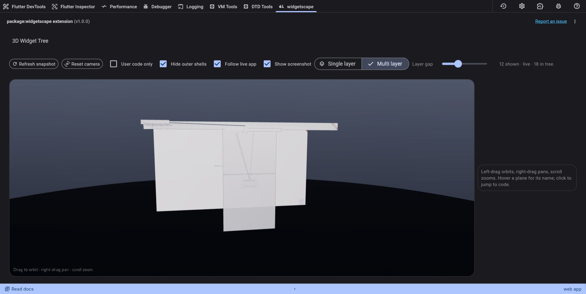
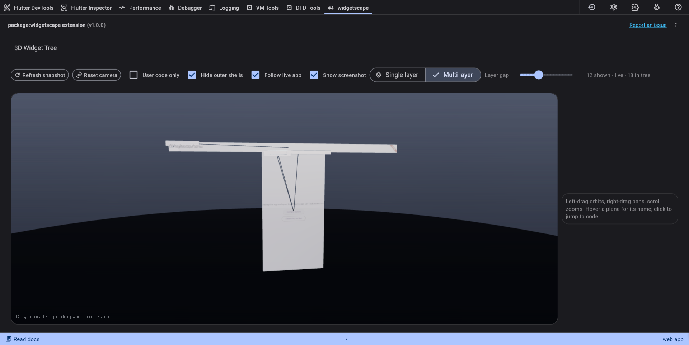
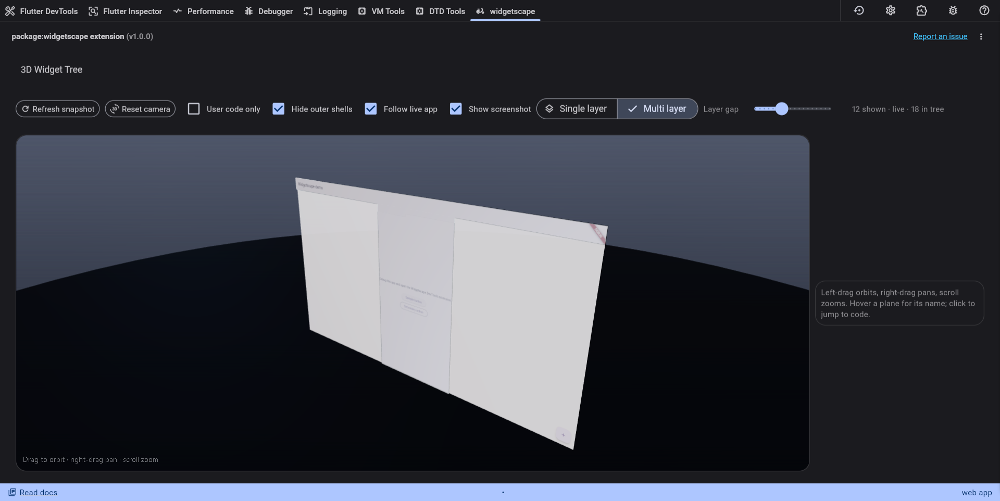

# Widgetscape

Flutter inspector that turns a live widget tree into a **3D map of the real screen**.

The screenshot sits in front. Behind it, each widget is a layer cut from the same pixels and aligned to its layout rect. Rotate the map to see nesting and overlap. Click a plane to select it in the running app.

It ships two surfaces:

- **DevTools extension** — orbit, pan, zoom, live follow, hide outer shells, single vs multi layer
- **MCP server** — agents snapshot, pick, select, and save screenshots against the VM service

Repository: [github.com/RajKavadia/widget-inspector-layered](https://github.com/RajKavadia/widget-inspector-layered)

## Screenshots











## Use in an app

Add a path or pub dependency, then open DevTools while the app is running and choose the **Widgetscape** tab.

```yaml
dev_dependencies:
  widgetscape_devtools: ^1.0.1
```

```bash
cd example
flutter run -d chrome
```

Hard-refresh DevTools after rebuilding the extension, then **Refresh snapshot**.

## MCP

```bash
dart run widgetscape_mcp --vm-uri ws://127.0.0.1:PORT/TOKEN=/ws
```

Or set `WIDGETSCAPE_VM_URI`. Tools: `widgetscape_connect`, `widgetscape_snapshot`, `widgetscape_pick`, `widgetscape_select`, `widgetscape_breadcrumb`, `widgetscape_save_screenshot`.

See `mcp/cursor.example.json`.

## Rebuild the extension

```bash
flutter build web --release
# copy build/web/* into extension/devtools/build/
```

Copy `web/tree_scape/scene.js` into `extension/devtools/build/tree_scape/` after scene edits.
